<div align="center">

<picture>
  <source media="(prefers-color-scheme: dark)" srcset=".github/assets/logo.svg">
  <source media="(prefers-color-scheme: light)" srcset=".github/assets/logo-light.svg">
  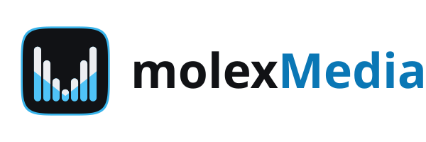
</picture>

<br/>

**A desktop toolkit for loudness, conversion, compression, extraction, editing, and playback, built on FFmpeg.**

<a href="https://github.com/molexxxx/molex-media-electron/actions/workflows/ci.yml"></a>
<a href="https://github.com/molexxxx/molex-media-electron/actions/workflows/build.yml"></a>
<a href="https://github.com/molexxxx/molex-media-electron/releases"></a>
<a href="LICENSE"></a>
<a href="https://github.com/molexxxx/molex-media-electron/releases"></a>

<br/>

[Download](#install) · [Features](#features) · [FFmpeg and yt-dlp](#ffmpeg-and-yt-dlp) · [Development](#development) · [Changelog](CHANGELOG.md) · [Website](https://media.molex.cloud) · [Report a bug](https://github.com/molexxxx/molex-media-electron/issues/new?template=bug_report.yml) · [Request a feature](https://github.com/molexxxx/molex-media-electron/issues/new?template=feature_request.yml)

</div>

<br/>

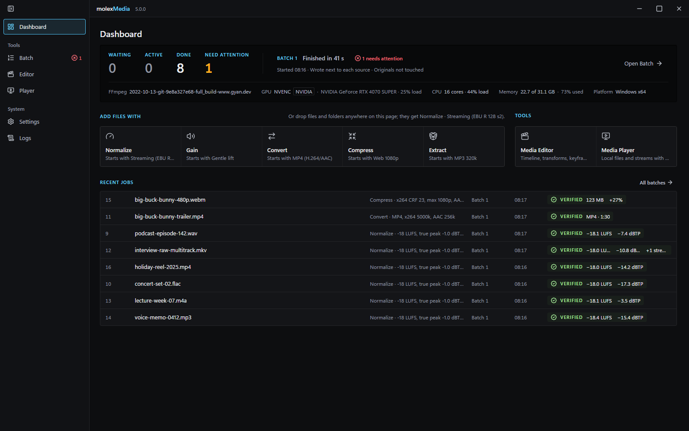

## What it does

molexMedia runs media jobs in batches on Windows, macOS, and Linux. You queue files, give each an operation and a preset, review what every job will write, run the batch on a pool of workers, and keep a history with measured results. Beside the batch tools there is an editor with Trim, Timeline, and Inspect, and a player for files and links. Everything runs through one FFmpeg install that the app downloads and verifies, or one already on the computer.

## Features

### Batch

Every file in the queue is a job with its own settings: an operation (Normalize, Gain, Convert, Compress, or Extract) and a preset, snapshotted when the job is added, so a later change to the defaults never touches a queued job. The inspector shows the selected jobs' settings in plain words, with a goal finder that answers common goals, such as podcast episodes or delivering to a European broadcaster, with one preset.

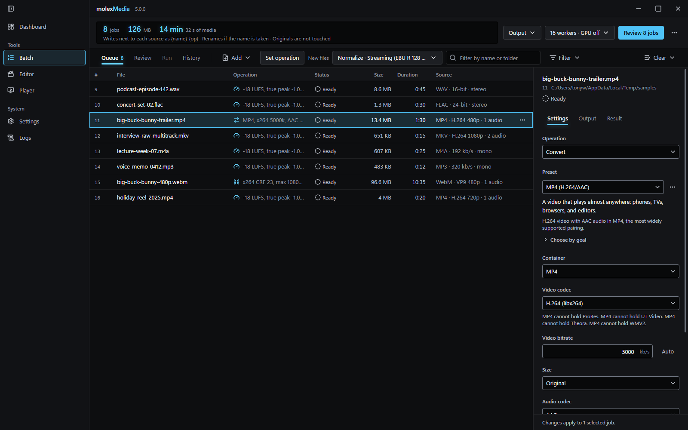

- Loudness presets are named after the documents they follow: EBU R 128, EBU R 128 s2 for streaming and s4 for film and series, ATSC A/85, the AES streaming recommendation, Apple Podcasts, and Spotify, plus Clear dialogue and Custom. Each preset states its source and tolerance. Loudness is measured with ebur128, the gain is planned from the measurement, and a true-peak limiter holds the ceiling.
- Convert, Compress, and Extract presets are described by what they produce (container, encoder, bit rate, size), never by a platform name. Multi-track sources keep every audio and subtitle stream the container can hold, and the inspector says what a container cannot hold.
- Review lists what each job will write before anything runs: the output file, the encoder, the streams kept, the planned FFmpeg command, and the files that would be replaced. Container limits are caught here, for example H.264 cannot be stored in WebM, so that output becomes MKV.
- Run shows progress per job and per operation, time left, speed, and the measured result of every finished job. Each output is decoded once more and measured against its plan before it is called verified. Pause, resume, cancel, and retry work mid-batch, and a job whose output cannot be placed waits for a decision: keep it, keep it under a new name, discard it, or retry.
- History keeps the newest 200 batches with the settings they used, the build they ran on, and how they ended, searchable by file or job number, with CSV and JSON reports and a rerun of returned jobs.
- Output is a policy per batch: a folder or next to each source, a file-name template with fields, what to do when a name is taken (rename, skip, or overwrite), source subfolders, and one folder per preset. Replace originals is chosen per batch and never kept as a default; replaced files go to the recycle bin unless you choose to keep them beside the new ones.
- Workers run jobs at once, automatically or at a fixed count. GPU encoding uses NVIDIA NVENC, Intel QSV, or AMD AMF with a session budget; only H.264 and HEVC have GPU encoders, lossless jobs stay on the CPU, and Review lists every job the GPU setting changes.

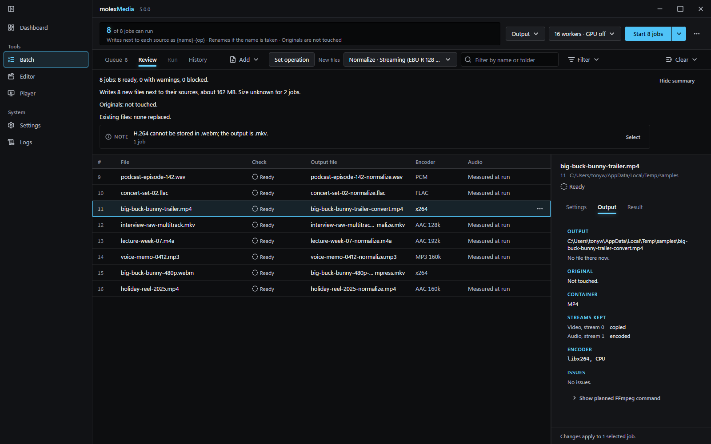

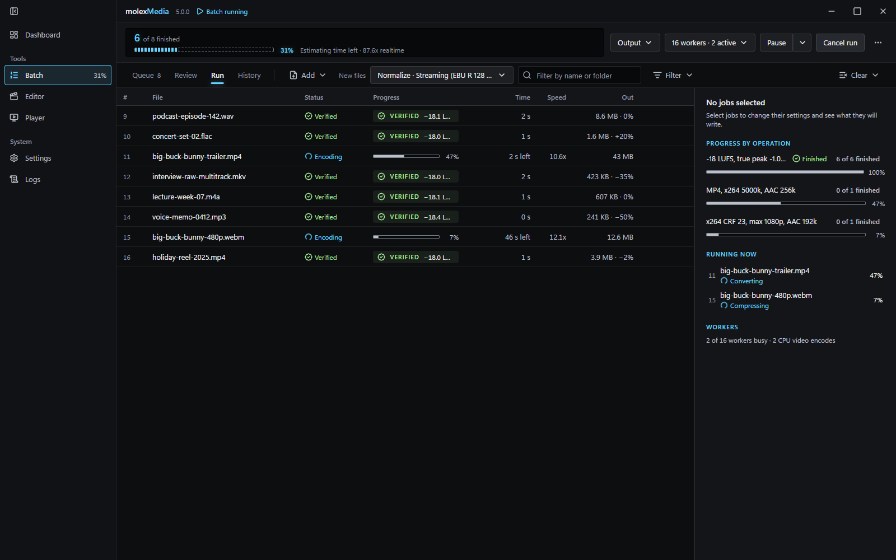

### Dashboard

The home view is a front panel: the counts of waiting, active, done, and jobs that need attention, the last batch, the machine's readiness (the FFmpeg build, GPU, CPU, memory, and platform), keys that add files with each operation starting from its default preset, the Editor and Player, and the latest settled jobs with their measured stamps. Files and folders dropped anywhere on it are queued with the default preset.

### Settings

- Batch: where batches write and what happens to files they meet, workers and GPU encoding, what applies while a batch runs (full or sampled video verification, process priority, keep awake, notifications), history retention, recent folders, and a reset.
- Presets: your presets by operation with rename and delete, the pinned keys Alt+1 to Alt+9, and the built-in presets, read-only, each loudness preset with its standard and sources.
- FFmpeg: the build in use with its version and source, the self-test result and when it ran, Re-run self-test, and Install the tested build when the build in use is not the one this version ships with.
- Application: app updates from GitHub Releases, the yt-dlp section (the version in use, last check, automatic updates, and a switch to use the yt-dlp found on this computer), what the close button does, how the window opens, interface size, spoken batch progress, and the browser YouTube cookies come from.

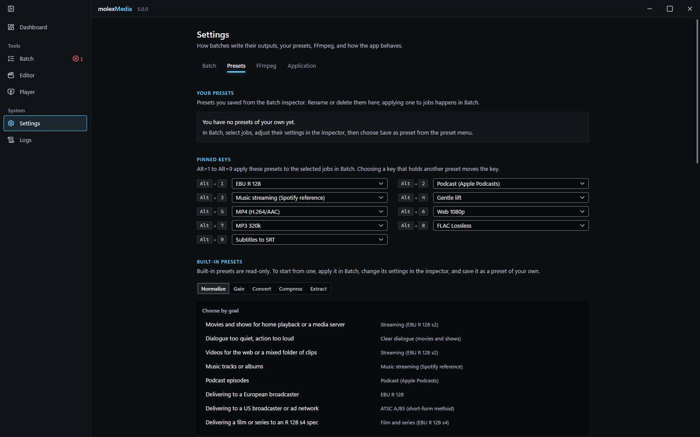

### Logs

Every line the main process and its jobs wrote, as one list: a level filter, a sources menu, search, and Follow new lines narrow and track it; Copy lines, Open log folder, and Clear act on it. Show log from a job in Batch narrows the view to that job or batch, a job's complete FFmpeg output opens beside its lines, and a selected line opens in full in the details pane.

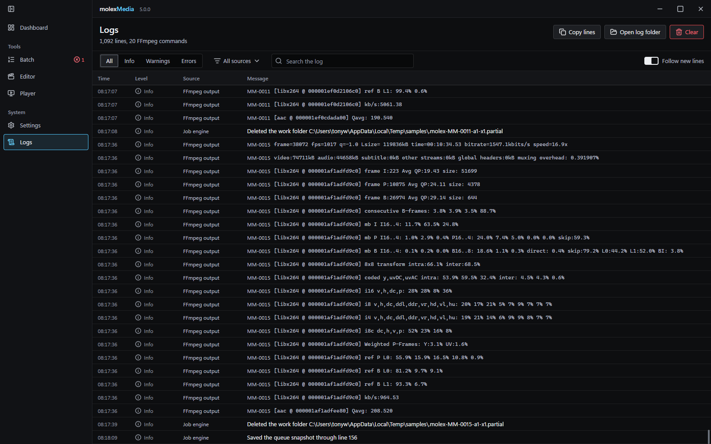

### First run

Setup is one screen. It says what molexMedia needs and why, downloads the FFmpeg build this version is pinned to with the percent, size, and speed shown, checks the download against the SHA-256 the app ships with, and self-tests it. Or choose a folder with an FFmpeg already on this computer, which is self-tested the same way. yt-dlp downloads the first time you open a link in the Player.

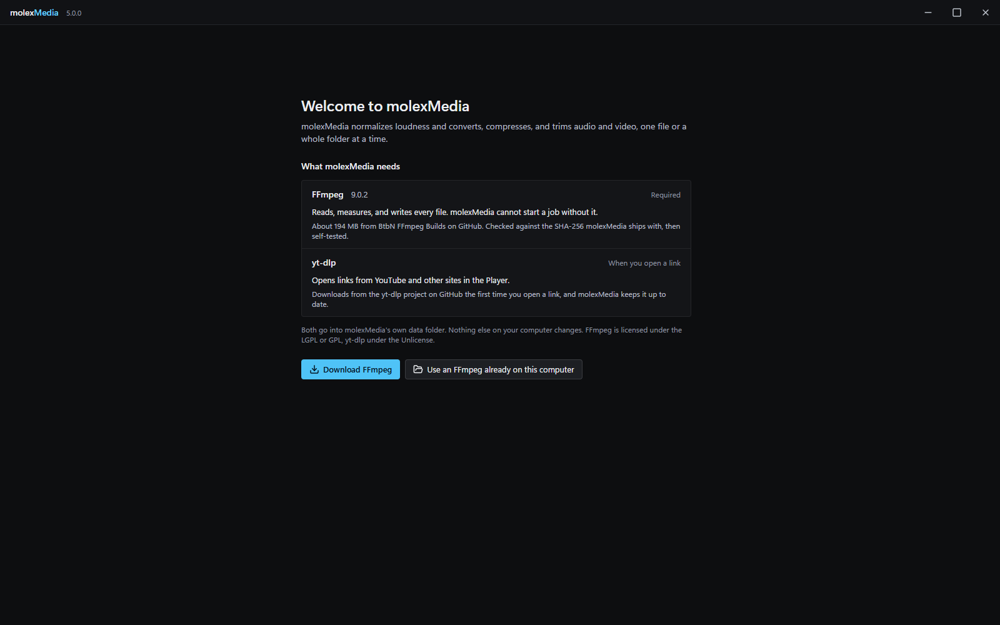

### Editor

- Trim: a preview with frame steps, in and out points with lit readouts, a filmstrip trim bar, and an export panel with the format and quality. Exports re-encode at a chosen quality and cut on the exact frame, or copy the streams for the fastest cut at the nearest keyframe, and a trimmed range can be added to the timeline.
- Timeline: a source bin, video and audio tracks, insert, overwrite, append, and on-top edits, select, trim, and split tools, snapping, zoom, and undo. The clip panel sets a clip's sound (mute, volume, pan) and its place in the picture (position, scale, rotation) with keyframes. Export chooses the range, format, size, quality, and audio bit rate.
- Inspect: the file's ffprobe report as plain name and value rows, the file, every stream, the tags, and the keyframes, each value plain first and technical second, with Copy. Leave streams out or edit the tags, then Save a copy, which remuxes losslessly to a new file.

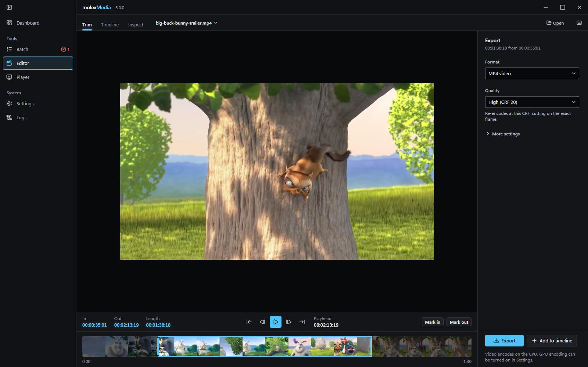

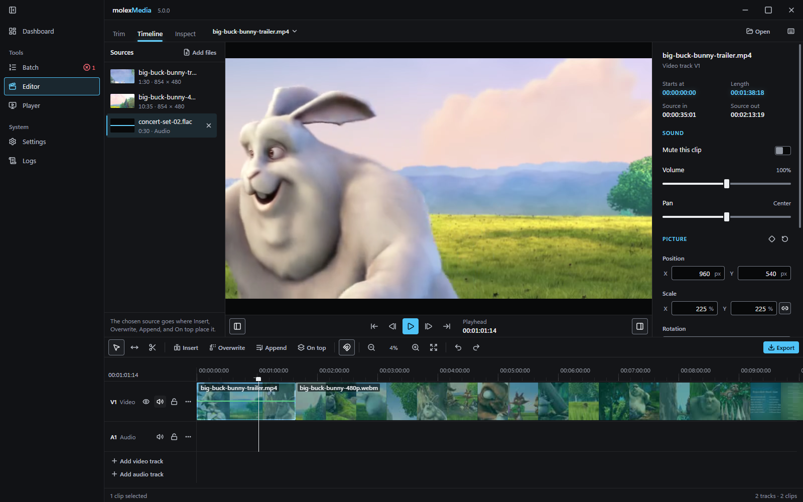

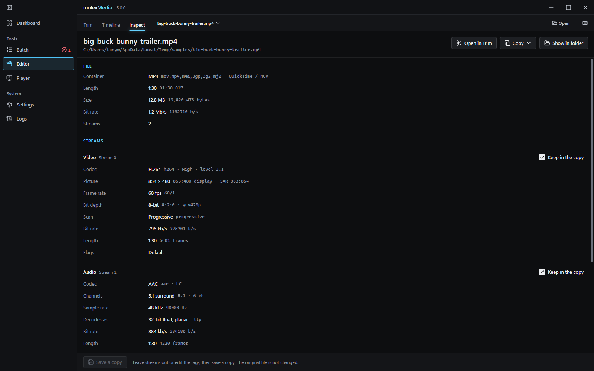

### Player

- Plays files and folders, and links through yt-dlp from YouTube and many other sites, with a playlist, shuffle, repeat, and recent links.
- Shows the video or a visualization (DMT, Space, Milkdrop, Plasma, Bars, Waveform, Horizon, or Rain) drawn from the playing audio.
- Plays each local file the cheapest way that works: directly when the browser engine decodes it, repackaged when only the container is in the way, or decoded by FFmpeg while it plays, with a hardware encoder when one is available. Links carry a sound quality and a picture quality, and a stream that cannot be played directly is downloaded first.
- Audio track and subtitle choice, with text subtitles shown over the picture or the visualization.
- Real full screen: the window goes full screen, the shell hides, and the controls fade with the pointer.
- Pop out: a small window that stays on top, with three sizes and a remembered size, and Back to the app.
- Media information: how the file is being played, then the file and each stream as a plain line with the technical values folded under it.

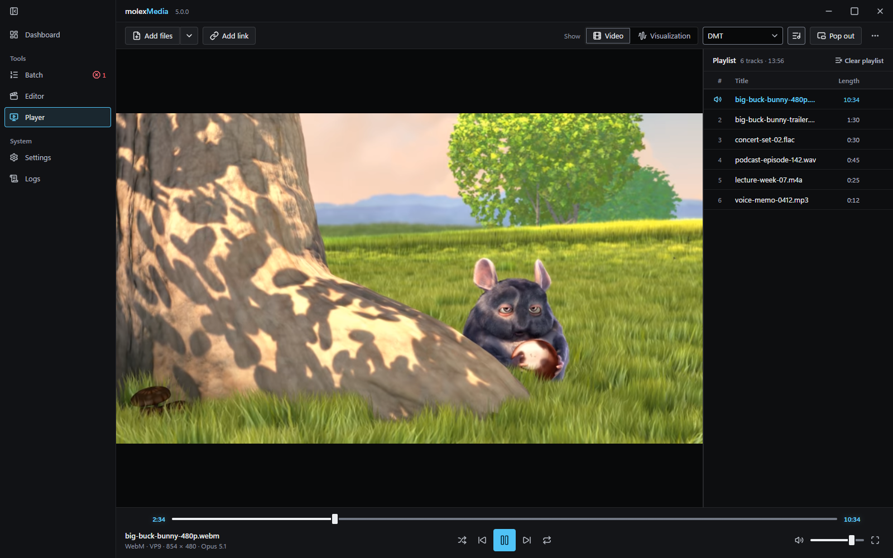

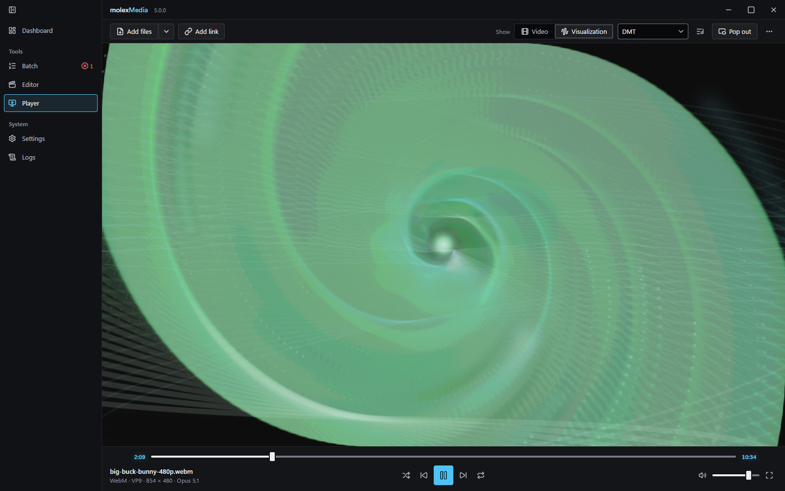

<p align="center">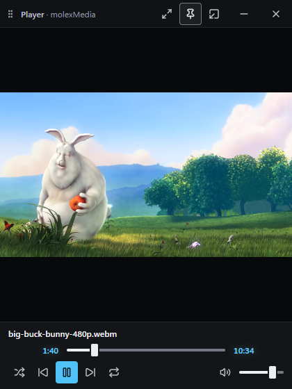</p>

The video in these screenshots is [Big Buck Bunny](https://peach.blender.org/) by the Blender Foundation, licensed [CC BY 3.0](https://creativecommons.org/licenses/by/3.0/).

## FFmpeg and yt-dlp

molexMedia does not bundle FFmpeg. On first run it downloads the build pinned in [`src/main/ffmpeg/pinned-builds.json`](src/main/ffmpeg/pinned-builds.json), which records each platform's download by URL, size, and SHA-256, verifies the digest while the archive streams to disk, extracts it into the app's own data folder, and runs a self-test (the encode chains, the loudness meter on dual mono and surround input, libsoxr, and the encoders) before any job runs. You can instead point the app at an FFmpeg already on this computer, which is checked and self-tested the same way. A build that fails the surround metering test cannot run loudness jobs on more than two channels; the app says so instead of writing a wrong level.

The Apple Silicon download is held at FFmpeg 7.1.1: the loudness meter in the newer macOS arm64 builds reads inputs with more than two channels 16 to 33 LU too loud, which would turn 5.1 sources far down, and 7.1.1 measures them correctly. A workflow checks newer builds' surround metering on Apple Silicon so the hold can be lifted once one passes.

yt-dlp is downloaded the first time you open a link, from the yt-dlp project's own releases. The release's checksum list must carry a valid signature by the yt-dlp signing key, and the binary must match its checksum, or nothing is installed. The app checks for updates and replaces the binary only while nothing is running it. A yt-dlp found on this computer can be used instead and is left alone.

## Install

Download the installer for your platform from the [latest release](https://github.com/molexxxx/molex-media-electron/releases/latest).

| Platform | Package |
|----------|---------|
| Windows (x64) | `molexMedia-<version>-Windows-Setup.exe`, an installer that lets you choose the folder |
| macOS (Intel and Apple Silicon) | `molexMedia-<version>-macOS-Installer.dmg`, one universal build |
| Linux (x64) | `molexMedia-<version>-Linux-Installer.deb` or `.rpm` |

The app checks GitHub Releases for updates and installs them itself; the switch is in Settings, Application, and an update waits while a batch runs.

Requirements: a 64-bit Windows, macOS, or Linux system, and a network connection on first run for the FFmpeg download (55 to 194 MB depending on the platform) unless you point the app at an FFmpeg already installed. GPU encoding is optional and uses NVIDIA NVENC, Intel QSV, or AMD AMF when one is present.

## Development

```bash
git clone https://github.com/molexxxx/molex-media-electron.git
cd molex-media-electron
npm install
npm run dev
```

CI runs on Node 22. `npm run dev` starts the app with hot reload against your real user data folder.

```bash
npx tsc -b --noEmit       # type check main, preload, and renderer
npm test                  # unit tests (vitest)
npm run test:coverage     # unit tests with the coverage thresholds CI enforces
npm run test:golden       # the audio pipeline measured on a real FFmpeg build
```

The golden suite finds `ffmpeg` and `ffprobe` in `MOLEX_FFMPEG_DIR` or on `PATH`, and CI runs it on several FFmpeg builds whenever the pipeline changes, weekly, and before every release.

```bash
npm run package           # installer for the current platform
npm run package:win       # Windows
npm run package:mac       # macOS
npm run package:linux     # Linux
```

Releases are built by the Release workflow when a `v*.*.*` tag is pushed, after the unit tests and the golden suite pass, with release notes generated from the commits.

Layout: `src/main` is the main process (the FFmpeg pipeline, the job engine, yt-dlp, the updater, and the tray), `src/preload` the bridge, `src/renderer` the React UI, and `src/shared` the job model, presets, and IPC contract they share. Tests live in `tests/main`, `tests/renderer`, and `tests/golden`. `website/` and `website-api/` are the project website and are separate from the app.

Built with Electron, electron-vite, React, TypeScript, Tailwind CSS, zustand, electron-store, electron-updater, electron-builder, youtube-dl-exec, and Vitest with Testing Library.

## Contributing

Bug reports and feature requests use the issue templates linked at the top. See [CONTRIBUTING.md](CONTRIBUTING.md) for branch naming, commit conventions, and the pull request flow.

## License

[MIT](LICENSE).
